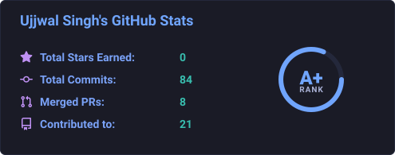
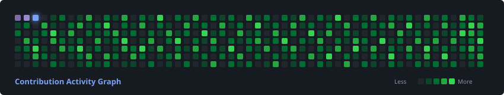

 

  <strong>Building scalable backend systems, exploring cloud technologies, and developing intelligent AI-powered applications.</strong>

---

## 👨‍💻 About Me

- 🎓 **Computer Science Engineering Student** focused on high-performance software engineering.
- ☕ **Passionate about Java and Backend Development**, building robust, enterprise-grade architectures.
- 🐹 **Exploring Golang** to construct concurrency-driven, microsecond-latency network services and APIs.
- ☁️ **Interested in Cloud Computing and distributed systems**, focusing on reliability, observability, and scale.
- 🤖 **Exploring Artificial Intelligence and Machine Learning**, integrating intelligent LLM agents into practical workflows.
- ⚙️ **Dedicated to scalable APIs, system architecture, and clean design patterns**.
- 🌱 **Continuously building real-world projects and contributing to Open Source**.

---

## 🎯 Current Focus

- 🚀 **Strengthening Core Foundations:** Java, Golang, and advanced Data Structures & Algorithms.
- 🏗️ **Backend Engineering:** Building scalable backend architectures, RESTful APIs, and asynchronous microservices.
- ☕ **Modern Frameworks:** Exploring Spring Boot ecosystem and high-throughput Go backend services.
- ☁️ **Cloud & Infrastructure:** Learning AWS cloud primitives, Docker containerization, and Kubernetes orchestration.
- 🧠 **AI & Machine Learning:** Exploring Large Language Models (LLMs), AI agent frameworks, and applied ML.
- 🌐 **Open Source:** Actively contributing to developer tooling and community open-source repositories.

---

## 🛠️ Tech Stack

### 💻 Programming Languages

  

### ⚙️ Backend Development

  

### ☁️ Cloud & DevOps

  

### 🗄️ Databases & Caching

  

### 🤖 AI & Machine Learning

  

---

## 🚀 Featured Projects

<table width="100%">
  <tr>
    <td width="50%" valign="top">
      <h3>♟️ <a href="https://student.chessy.in">Chessy</a></h3>
      
An online chess education platform featuring coach dashboards, interactive learning curricula, and intelligent learning experiences tailored for students and academies.

      

        
      

    </td>
    <td width="50%" valign="top">
      <h3>🌱 <a href="https://github.com/ThakurUjjwal1706/AgriSense">AgriSense</a></h3>
      
An AI-powered agricultural system designed for real-time crop disease detection, weather insights, and voice-assisted farmer advisory to maximize crop yield and decision-making.

      

        
      

    </td>
  </tr>
  <tr>
    <td width="50%" valign="top">
      <h3>💼 <a href="https://github.com/ThakurUjjwal1706/TechBiz-VyaaparSathi">TechBiz - VyaaparSathi</a></h3>
      
A business management solution designed for SMEs and merchants, offering streamlined GST-compliant billing, inventory management, and digital accounting workflows.

      

        
      

    </td>
    <td width="50%" valign="top">
      <h3>🌐 <a href="https://site-guide-rho.vercel.app/">SiteGuide</a></h3>
      
An interactive web navigation and guided user onboarding portal built to streamline digital walkthroughs, feature discovery, and product adoption.

      

        
      

    </td>
  </tr>
</table>

---

## 📊 GitHub Analytics

  
  

---

## 🔥 GitHub Streak

  

---

## 📈 Contribution Activity

  

---

## 🌐 Connect With Me

  
  &nbsp;
  
  &nbsp;
  
  &nbsp;
  

 

---

  
<strong>💡 Building Today. Innovating Tomorrow.</strong>

  

